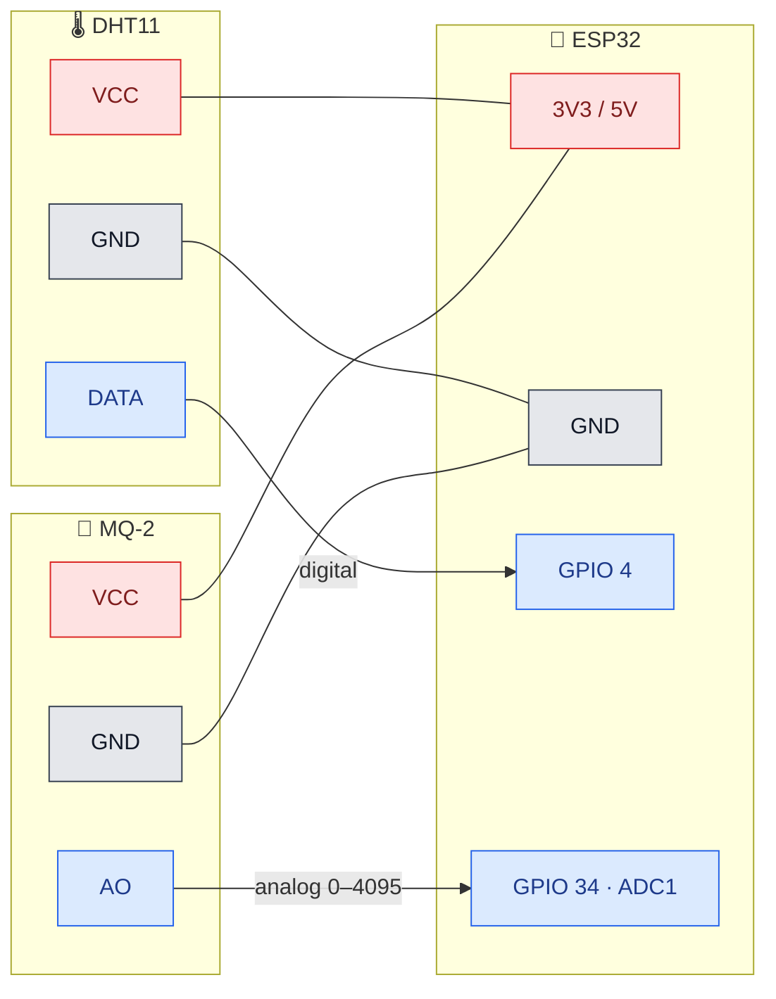
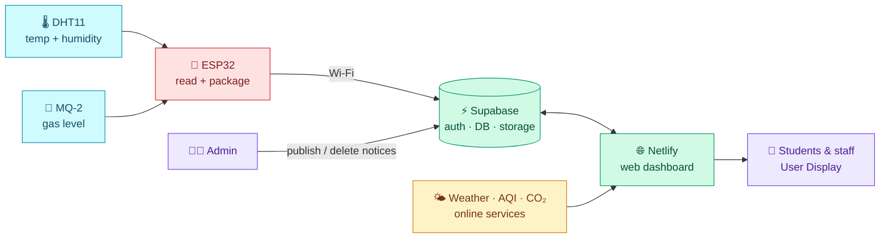
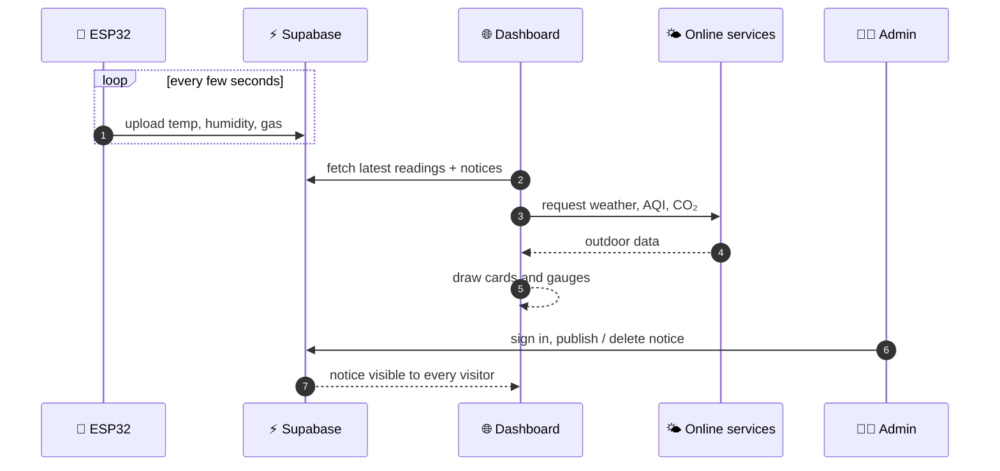
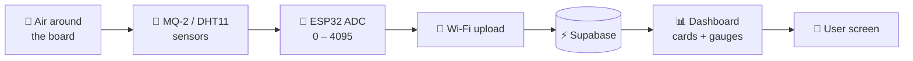
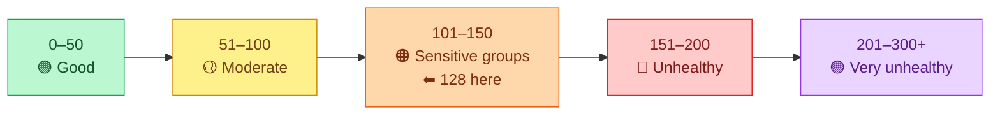
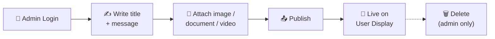
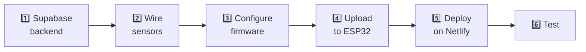
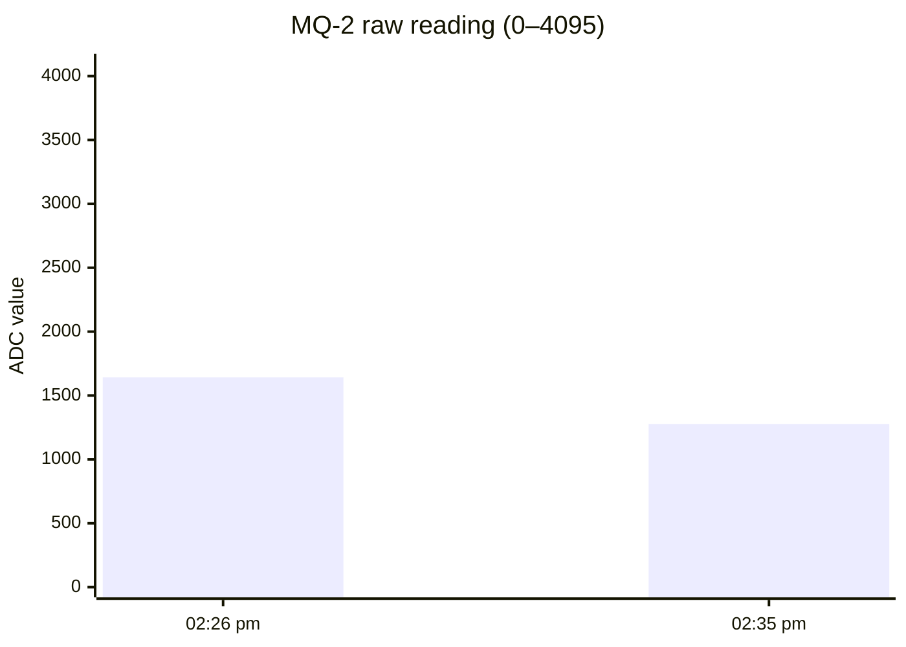
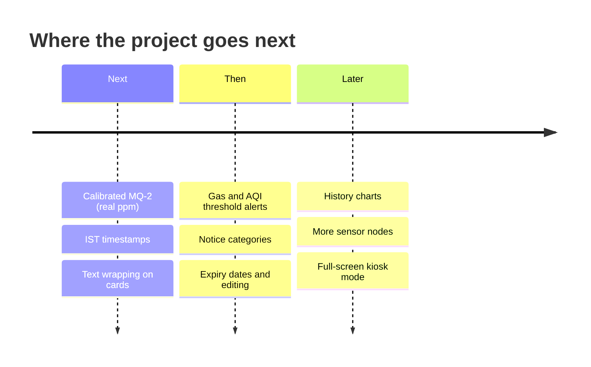

<div align="center">


<br/>


### 🌐 [**Live Demo → smartnotice-live-dashboard.netlify.app**](https://smartnotice-live-dashboard.netlify.app)


*ESP32 + DHT11 + MQ-2 feeding the live dashboard*

[📖 Overview](#-overview) · [🔌 Wiring](#-wiring-diagram) · [🏗️ Architecture](#️-system-architecture) · [🚀 Setup](#-getting-started) · [📸 Results](#-results) · [🔮 Roadmap](#-roadmap)

</div>

---

## 📖 Overview

A paper notice board is slow to update, easy to miss, and says nothing about the conditions around campus. The **SRM AP Smart Notice Board** fixes that. An **ESP32** reads a **DHT11** and an **MQ-2** sensor and uploads the values to **Supabase**. A **Netlify-hosted dashboard** shows them live next to the time, weather, **AQI** and **CO₂** level.

Admins sign in and publish notices with text, image, document or video (up to 50 MB). Everyone else opens the **User Display** on any phone or PC.

> 💡 **One page, two answers:** *What's new on campus?* and *What are the conditions right now?*

### 🆚 Paper vs Smart

| | 📄 Paper board | 📟 Smart Notice Board |
|---|---|---|
| ⏱️ **Update speed** | Printed and pinned by hand | **Seconds**, from a browser |
| 🌍 **Reach** | People who walk past | **Anyone with the link** |
| 🎞️ **Content** | Text and pictures | **Text, image, document, video** |
| 🗑️ **Removal** | Taken down by hand | **One-click delete** |
| 🌡️ **Extra info** | None | **Live time, weather, AQI, CO₂, sensors** |
| 🔐 **Who can post** | Anyone with a pin | **Signed-in admins only** |

---

## ✨ Features

<table>
<tr>
<td align="center" width="25%">📡<br/><b>Live Sensors</b><br/><sub>Temp, humidity and gas from the ESP32</sub></td>
<td align="center" width="25%">🟢<br/><b>Board Status</b><br/><sub>Online + "Updated N s ago"</sub></td>
<td align="center" width="25%">🌦️<br/><b>Campus Info</b><br/><sub>Clock, weather and AQI for Mangalagiri</sub></td>
<td align="center" width="25%">📊<br/><b>Smart Gauges</b><br/><sub>Gas, CO₂ and AQI with colour bands</sub></td>
</tr>
<tr>
<td align="center">🔐<br/><b>Admin Login</b><br/><sub>Supabase Authentication</sub></td>
<td align="center">🖼️<br/><b>Rich Notices</b><br/><sub>Image, document, video (50 MB)</sub></td>
<td align="center">👀<br/><b>Public Display</b><br/><sub>Read-only <code>/notices</code> page</sub></td>
<td align="center">☁️<br/><b>Always On</b><br/><sub>Netlify hosting, no server</sub></td>
</tr>
</table>

---

## 🧰 Components

<table>
<tr>
<td>

### 🔧 Hardware
| # | Part | Role |
|---|------|------|
| 1 | 🧠 ESP32 board | Controller + Wi-Fi |
| 2 | 🌡️ DHT11 | Temp + humidity |
| 3 | 💨 MQ-2 | Gas and smoke |
| 4 | 🔗 Breadboard + wires | Connections |
| 5 | 🔌 USB / 5 V | Power + upload |
| 6 | 📶 Wi-Fi | Data link |

</td>
<td>

### 💻 Software
| Tool | Use |
|------|-----|
| 🛠️ Arduino IDE | Firmware |
| 🔑 Supabase | Auth, DB, storage |
| 🚀 Netlify | Hosting |
| 🌤️ Online APIs | Weather, AQI, CO₂ |
| 🌐 Browser | Dashboard |

</td>
</tr>
</table>

---

## 🔌 Wiring Diagram



| Sensor Pin | ESP32 Pin | Notes |
|---|---|---|
| 🔴 DHT11 VCC | 3.3 V / 5 V (per module) | Power |
| ⚫ DHT11 GND | GND | Common ground |
| 🔵 DHT11 DATA | **GPIO 4** | Digital temp + humidity |
| 🔴 MQ-2 VCC | 5 V / VIN | Heater and electronics |
| ⚫ MQ-2 GND | GND | Common ground |
| 🔵 MQ-2 AO | **GPIO 34** (ADC1) | Analog, read as 0–4095 |

> [!IMPORTANT]
> Connect the MQ-2 analog output to an **ADC1** pin. ADC2 pins are unreliable on the ESP32 while Wi-Fi is on, and this project uses Wi-Fi all the time.

<div align="center">
<table>
<tr>
<td align="center"><br/><sub><b>Prototype with live dashboard</b></sub></td>
<td align="center"><br/><sub><b>Annotated: ESP32 · DHT11 · MQ-2 · breadboard · USB · dashboard</b></sub></td>
</tr>
</table>
</div>

---

## 🏗️ System Architecture



### 🔁 Four layers: Sense → Think → Share → Act

| 1️⃣ Sense | 2️⃣ Think | 3️⃣ Share | 4️⃣ Act |
|:---:|:---:|:---:|:---:|
| DHT11 and MQ-2 turn the air into signals | ESP32 reads, packages and uploads over Wi-Fi | Supabase stores; Netlify app presents | Admins publish; users read |

### 📨 Message Flow



<details>
<summary>🖼️ <b>Original architecture figures</b></summary>
<br/>
<div align="center">

<br/><br/>

</div>
</details>

---

## ⚙️ How It Works



The ESP32's **12-bit ADC** gives 2¹² = **4096 levels**. A higher raw value means a higher *relative* gas level, which is mapped to a percentage for the gauge.

```text
MQ-2 raw scale (12-bit ADC)

0 ├───────────────┬─────────────────────────────────────────────┤ 4095
                  │
   1277 ▓▓▓▓▓▓▓░░░░░░░░░░░░░░░░░░░░░░░░░░░░░░░░░░░  Capture 2
   1642 ▓▓▓▓▓▓▓▓▓▓░░░░░░░░░░░░░░░░░░░░░░░░░░░░░░░░░  Capture 1 → 39 % · Normal
```

> [!NOTE]
> The MQ-2 value is a **relative reading, not calibrated ppm**. Calibrate against known gas levels for real concentrations.

### 🎨 Gauge Colour Bands

| Gauge | Scale | Bands |
|---|---|---|
| 💨 **Gas level** | 0–100 % relative | 🟢 Normal → 🟡 → 🟠 → 🔴 High |
| 🫁 **CO₂** | 350 – 1000+ ppm (outdoor ≈ 420) | 🟢 Normal → 🟡 → 🟠 → 🔴 |
| 🌫️ **Pollution (AQI)** | 0 – 300+ | see below |



---

## 📝 Notices and Screens

### 🔄 Publishing Workflow



| Field | Required | Description |
|---|:---:|---|
| 🏷️ Notice Title | ✅ | Short heading |
| 💬 Notice Message | ✅ | Full text |
| 🖼️ Image | ➖ | Preview shown with the notice |
| 📄 Document | ➖ | "Open attached document" link |
| 🎞️ Video | ➖ | Maximum 50 MB |
| 🕒 Published time | 🤖 | Saved automatically (UTC) |

| Screen | Purpose |
|---|---|
| 🏠 **Home dashboard** | Campus cards, board sensors, status, gauges |
| 👀 **User Display** `/notices` | Public read-only notices |
| 🔐 **Admin Login** | Email + password via Supabase Auth |
| 🧑‍💼 **Admin Dashboard** | Notice form with attachments |
| 📋 **Published Notices** | Count, cards, Delete button |

---

## 🚀 Getting Started



**1️⃣ Create the backend** – Create a Supabase project, add the admin account under *Authentication*, and prepare the notices table and a storage bucket.

**2️⃣ Wire the sensors** – Follow the [wiring diagram](#-wiring-diagram).

**3️⃣ Configure the firmware** – Open the sketch in Arduino IDE and fill in the settings:

```cpp
const char* WIFI_SSID     = "YOUR_WIFI_NAME";
const char* WIFI_PASSWORD = "YOUR_WIFI_PASSWORD";
// Supabase project URL and key
```

**4️⃣ Upload** – Select your ESP32 board and port, upload over USB and watch the Serial Monitor.

**5️⃣ Deploy** – Publish the dashboard folder on Netlify and connect it to Supabase.

**6️⃣ Test** – Check **Board status = Online**, sign in as admin and publish a test notice.

> [!WARNING]
> Never commit Wi-Fi passwords, Supabase keys or admin credentials to a public repo. Keep them in a local config listed in `.gitignore`.

<details>
<summary>🧪 <b>Calibrating the MQ-2</b></summary>

1. Power the module and let it warm up until the reading settles.
2. In clean air, note the stable raw value (your "Normal" baseline).
3. Briefly expose it to a safe test source and confirm the value and gauge rise.
4. Adjust the percentage mapping if the gauge doesn't match the observed range.
</details>

<details>
<summary>🛠️ <b>Troubleshooting</b></summary>
<br/>

| Symptom | Likely cause | What to try |
|---|---|---|
| 🔴 Board not Online | No power / Wi-Fi | Check USB power, Wi-Fi name + password, internet |
| 🔴 Gas stuck at 0 or 4095 | Loose AO wire / wrong pin | Re-check AO → ADC1 pin and module power |
| 🟠 Temp or humidity missing | DHT11 data wire loose | Reseat data and power wires |
| 🟠 Cannot sign in | Wrong credentials | Re-enter the ones set in Supabase Auth |
</details>

---

## 📸 Results

Tested with hardware and website running together on 11 November 2026.

<div align="center">
<table>
<tr>
<td align="center"><br/><sub><b>🏠 Home dashboard</b></sub></td>
<td align="center"><br/><sub><b>📊 Gas · CO₂ · AQI gauges</b></sub></td>
</tr>
<tr>
<td align="center"><br/><sub><b>🔐 Admin login</b></sub></td>
<td align="center"><br/><sub><b>✍️ Create a notice</b></sub></td>
</tr>
<tr>
<td align="center" colspan="2"><br/><sub><b>📋 Published notices: document link, image preview, Delete button</b></sub></td>
</tr>
</table>
</div>

### 📈 Live Readings

| Reading | 02:26 pm | 02:35 pm |
|---|:---:|:---:|
| ☀️ Outdoor temperature | 30.1 °C | 30.1 °C |
| 🌫️ Live AQI | 128 | 127 |
| 🌡️ Board temperature (DHT11) | 23.5 °C | 23.7 °C |
| 💧 Board humidity (DHT11) | 71 % | 71 % |
| 💨 Gas raw (MQ-2) | 1642 / 4095 | 1277 / 4095 |
| 🟢 Board status | Online · 2 s ago | Online · 11 s ago |



### ✅ Test Cases

| Feature | Result |
|---|:---:|
| Live board readings | ✅ |
| Board status (Online + seconds) | ✅ |
| Clock and campus info | ✅ |
| Gas, CO₂, AQI gauges | ✅ |
| Admin sign-in | ✅ |
| Publish notice with attachments | ✅ |
| Delete notice | ✅ |

---

## ⚖️ Advantages and Limitations

| ✔️ Advantages | ✖️ Limitations |
|---|---|
| 💰 Low cost, easy-to-find parts | 📏 MQ-2 value is relative, not ppm |
| ⚡ Instant notices on any device | 🌡️ DHT11 has basic accuracy |
| 🎞️ Image, document and video notices | ✂️ Long header text can be cut off |
| 📊 Sensors + weather + AQI + CO₂ together | 🕒 Timestamps in raw UTC |
| 🔐 Secure admin sign-in | 🔕 No automatic alerts |
| ☁️ Hosted online | 📶 Needs Wi-Fi and internet |

## 🔮 Roadmap



---

## 🎬 Demo Video

A ~2 minute walkthrough of the dashboard, live sensor readings, admin sign-in and notice publishing is in `Website_Video.mp4`.

---

## 🙏 Credits

| Role | Name |
|---|---|
| 🧭 **Project guidance** | Anil Dasaroju |
| 🙌 **Special thanks** | A. BalaMurgan (Head, Skill Development) · A. Sagar (Manager, Skill Development) |
| 👨‍💻 **Developed by** | P. M. Shoaib Khan · G. Indra Nag · M. Jayanth Siva Srinivas · P. Joshi · Sk. Imran |

Built at **SRM University-AP · Skill Development and Embedded Systems**.

<details>
<summary>📚 <b>References</b></summary>

- Espressif Systems: ESP32 datasheet and Arduino-ESP32 docs
- Aosong: DHT11 datasheet · Hanwei Electronics: MQ-2 datasheet
- Supabase docs (Auth, Database, Storage) · Netlify docs
- US EPA: Air Quality Index categories
</details>

---

<div align="center">

**Made with ❤️ by Pathan Mohammad Shoaib Khan**

[](https://github.com/shoaib725)
[](https://linkedin.com/in/shoaibkhan725)

⭐ If you like this project, give it a star!

</div>
